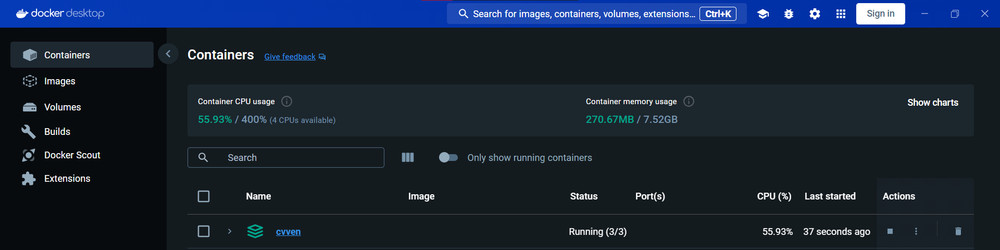
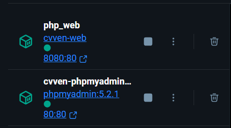
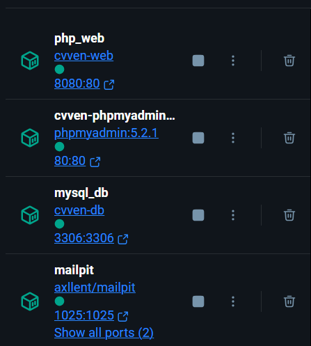
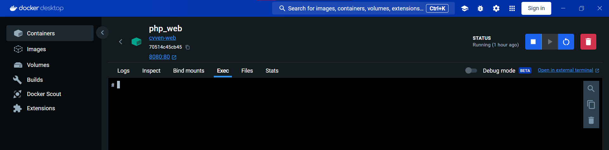

# CVVEN

CVVEN est une application web de réservation de séjours dans un village de vacances situé dans le Jura, développée dans le cadre d’un projet scolaire. Elle permet aux utilisateurs de réserver des hébergements pendant les vacances scolaires.

## 🚀 Stack Technique

**Frontend:** HTML, Bootstrap, Javascript

**Backend:** PHP, Codeigniter 4

**base de données:** MySQL

**Conteneurisation:** Docker & Docker Compose

## 📦 Installation rapide avec Docker

### Prérequis
- Docker Desktop
  - [Installer Docker sur Ubuntu](https://docs.docker.com/desktop/setup/install/linux/ubuntu/)
  - [Installer Docker sur Windows](https://docs.docker.com/desktop/setup/install/windows-install/)

### Étapes d'installation

```bash
git clone https://github.com/AffaneSafouane/CVVEN.git 
cd CVVEN
docker compose up -d
```

⚠️ Assurez-vous que les ports utilisés par les conteneurs (ex: 80, 8080, 3306) ne soient pas occupés (par XAMPP ou autre).

### Configuration Requise

Pour que le projet fonctionne correctement, vous devez renommer certains fichiers de configuration :
1. Depuis le dossier docker, copier .exemple.env à la racine du projet et renommer en .env.
2. Dans src/app/public/, copier .exemple.htaccess et renommer en .htaccess
3. Dans src/, copier .exemple.env et renommer en .env.

### Accès MySQL
- Utilisateur : root
- Mot de passe : adminSQL

## 🌐 Accès à l'application
Vous pouvez accéder à l’application et à phpMyAdmin via Docker Desktop :
1. Ouvrir Docker Desktop
2. Cliquer sur le projet cvven



3. Cliquer sur le lien correspondant au port :
   - http://localhost:8080 : Application web
   - http://localhost:80 : phpMyAdmin


  
## 🛠️ Commandes utiles pour le débogage
Si vous souhaitez exécuter des commandes depuis le terminal d'un conteneur vous devez exécuter les commandes suivantes : 

- Serveur web (PHP)
```bash
docker exec -it php_web sh
```

- Base de données (MySQL)
```bash
docker exec -it mysql_db sh
```

- phpmyadmin
```bash
docker exec -it cvven-phpmyadmin sh
```

Ou via l'interface Docker Desktop :
1. Cliquer sur le projet (cvven)


2. Sélectionner le conteneur voulu (ex: php_web ou mysql_db)



3. Aller dans l’onglet Exec pour ouvrir un terminal interactif



## ✅ Fonctionnalités principales
- Recherche et réservation de logements disponibles

- Interface d’administration (gestion des utilisateurs, réservations, logements…)

- Authentification utilisateurs

- Connexion à une base de données MySQL

- Interface utilisateur responsive grâce à Bootstrap

## 🙋‍♂️ Équipe projet
Projet réalisé dans le cadre d’un module scolaire avec la participation de plusieurs étudiants.
N'hésitez pas à consulter le dépôt GitHub pour plus de détails sur les contributeurs.

## 💡 À améliorer (pistes futures)
- Ajouter des tests automatisés (unitaires et fonctionnels)

- Améliorer la sécurité de l’authentification (ex: jetons CSRF)

- Mettre en place une API REST pour les réservations

- Ajouter une interface mobile plus responsive

- Intégrer un système de paiment

- Ajouter des commentaires